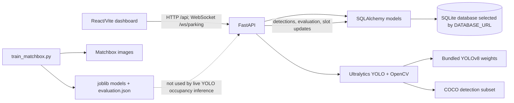
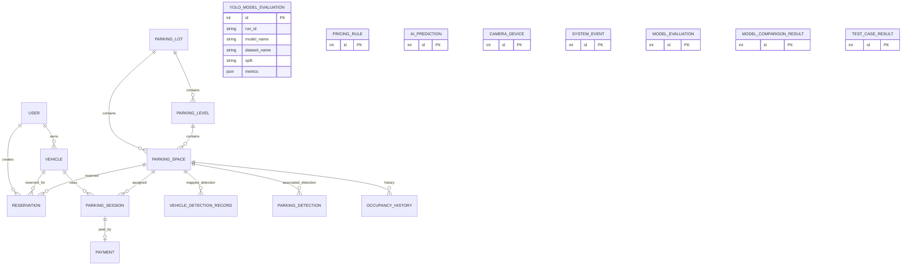
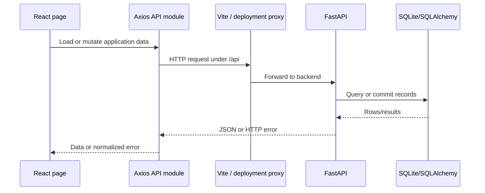
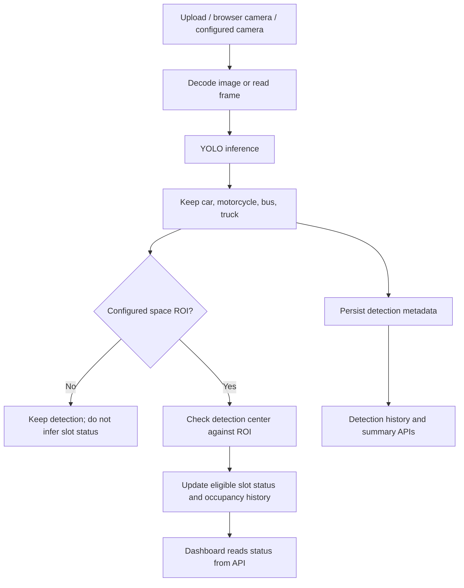
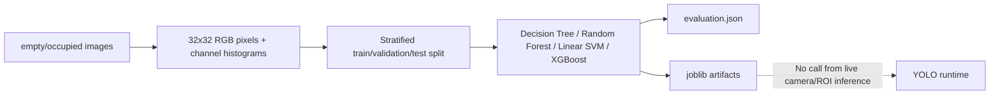
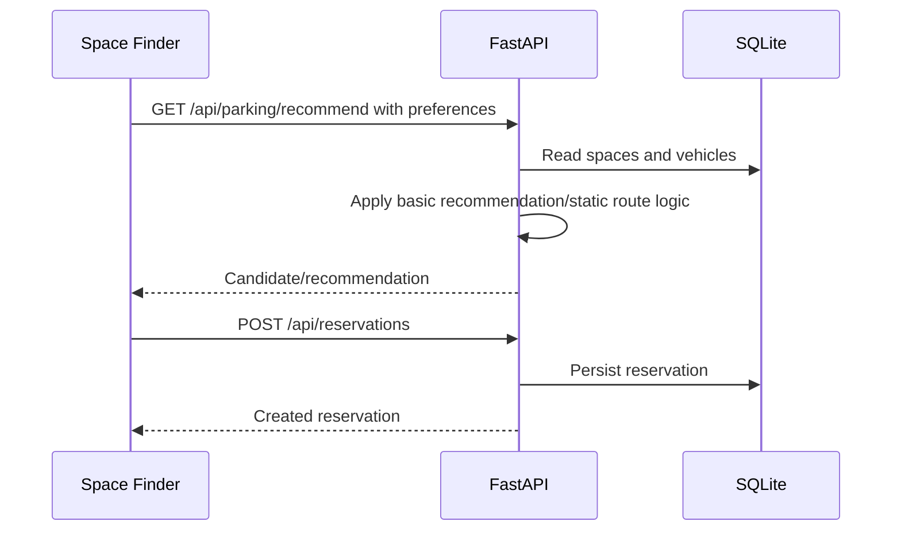
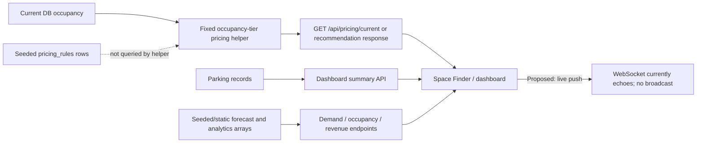

# ParkWise — Complete Codebase Documentation

## 1. Scope and evidence

This document describes the existing ParkWise checkout. It does not propose that demo data, stored metrics, configured model assets, or UI labels are equivalent to a production deployment. Statements about functionality are based on the source, configuration, local datasets, bundled evaluation artifacts, existing SQLite files, and checks performed on this checkout.

Generated or dependency directories (`node_modules`, Python virtual environments, `dist`, `__pycache__`, and cache/build outputs) are omitted from the source tree below. Database files and model/data artifacts are retained in the tree because they are part of the checked-out project state.

## 2. Project overview

| Item | Finding |
|---|---|
| Project name | ParkWise |
| Purpose | A parking-management dashboard prototype combining parking-space inventory, vehicles and reservations, analytics, route recommendations, and camera/image/video vehicle detection. |
| Problem addressed | Give an operator a view of parking capacity and occupancy, manage parking records, and experiment with automatic vehicle detection. |
| Target users | The UI is primarily presented as a parking administrator/operator dashboard. A driver-oriented space-finder/reservation flow is also present. |
| Frontend | React 19, React Router 7, Vite 8, Recharts, Axios, and Lucide icons. |
| Backend | FastAPI, Pydantic 2, SQLAlchemy 2, and Uvicorn. |
| Data and AI | SQLite by default; Ultralytics YOLOv8 for vehicle detection/evaluation; a separate scikit-learn/XGBoost parking-image classification experiment. OpenCV and NumPy support image/video inference. |
| State | Relational records are stored through SQLAlchemy; some display preferences and the frontend sign-in marker are stored in browser `localStorage`. |

### High-level architecture



The Matchbox classifier training/evaluation workflow is separate from the YOLO inference and camera-to-slot workflow. The UI presents several operational concepts together, but some of the data behind those views is seeded or static, as noted below.

## 3. Repository structure

The following is the observed project structure, abbreviated only for repeated image files and generated content:

```text
ParkWise/
├── .env
├── .vscode/
│   └── settings.json
├── README.md
├── index.html
├── package.json
├── package-lock.json
├── vite.config.js
├── public/
│   ├── favicon.svg
│   └── icons.svg
├── src/
│   ├── main.jsx
│   ├── App.jsx
│   ├── App.css
│   ├── index.css
│   ├── assets/
│   │   ├── hero.png
│   │   ├── react.svg
│   │   └── vite.svg
│   ├── api/
│   │   ├── ai.js
│   │   ├── client.js
│   │   ├── dashboard.js
│   │   ├── parking.js
│   │   ├── payments.js
│   │   ├── reservations.js
│   │   └── vehicles.js
│   ├── pages/
│   │   └── AIDetectionPage.jsx
│   └── styles/
│       └── ai-detection.css
├── backend/
│   ├── .env.example
│   ├── alembic.ini
│   ├── requirements.txt
│   ├── seed.py
│   ├── train_matchbox.py
│   ├── app/
│   │   ├── __init__.py
│   │   ├── main.py
│   │   ├── models.py
│   │   ├── ai_routes.py
│   │   └── core/
│   │       ├── config.py
│   │       ├── database.py
│   │       └── security.py
│   ├── tests/
│   │   └── test_ai_routes.py
│   ├── alembic/
│   │   └── env.py
│   ├── logs/
│   ├── parkwise.db
│   └── runs/
│       └── detect/
│           └── train/
├── data/
│   ├── parkwise_dataset.zip
│   ├── parkwise_occupancy_forecast.csv
│   ├── parkwise_parking_spaces.csv
│   ├── coco_vehicle_benchmark/           # Local-only; excluded from Git due to size
│   │   ├── annotations/
│   │   │   └── instances_val2017.json
│   │   ├── archives/
│   │   │   ├── annotations_trainval2017.zip
│   │   │   └── val2017.zip
│   │   ├── dataset/
│   │   │   ├── coco2017-subset.yaml
│   │   │   ├── images/val2017/       # 5,000 JPEG files
│   │   │   └── labels/val2017/       # YOLO-format labels
│   │   └── weights/
│   │       ├── yolov8n.pt
│   │       ├── yolov8s.pt
│   │       └── yolov8m.pt
│   ├── matchbox_cars_parkinglot/
│   │   ├── empty/
│   │   └── occupied/
│   └── matchbox_evaluation/
│       ├── decision_tree.joblib
│       ├── evaluation.json
│       ├── random_forest.joblib
│       ├── scaler.joblib
│       ├── svm_linear.joblib
│       └── xgboost.joblib
├── parkwise.db
└── runs/
    └── detect/
        └── train/
```

### Important directories and files

| Path | Responsibility |
|---|---|
| `src/App.jsx` | Main single-page application, navigation, dashboards, forms, data loading, comparison charts, and most UI pages. |
| `src/pages/AIDetectionPage.jsx` | Browser camera, uploads, CCTV selection, inference controls, detection display, and YOLO evaluation UI. |
| `src/api/` | Axios-backed API functions grouped by dashboard, parking, vehicles, reservations, payments, and AI. |
| `src/App.css`, `src/index.css`, `src/styles/ai-detection.css` | Application, global, and AI-detection styling. |
| `backend/app/main.py` | FastAPI setup, startup, API routes, route/recommendation logic, pricing, analytics, auth, and WebSocket endpoint. |
| `backend/app/ai_routes.py` | YOLO inference, upload/camera handling, ROI-to-space occupancy updates, detection history, and model evaluation. |
| `backend/app/models.py` | SQLAlchemy persistence entities. Pydantic request/response models are declared in `backend/app/main.py`; no separate `schemas.py` file exists. |
| `backend/app/core/` | Environment configuration, database session/engine setup, password hashing, and token helpers. |
| `backend/seed.py` | Demo parking, user, reservation, and pricing data initialization. |
| `backend/train_matchbox.py` | Separate classical-model experiment for empty/occupied parking images. |
| `backend/tests/test_ai_routes.py` | The only discovered backend test module. |
| `backend/alembic.ini`, `backend/alembic/env.py` | Alembic configuration/environment; no revision scripts were found. |
| `data/coco_vehicle_benchmark/` | Local COCO validation images, annotations, YOLO labels, dataset YAML, archives, and detector weights; excluded from Git due to size. |
| `data/matchbox_cars_parkinglot/` | Empty/occupied parking images used by the Matchbox classifier script. |
| `data/matchbox_evaluation/` | Saved classical-model artifacts and one recorded evaluation JSON. |
| `parkwise.db`, `backend/parkwise.db` | Two distinct SQLite database files; which one is used depends on the backend process working directory when the default URL is used. |
| `runs/`, `backend/runs/`, `backend/logs/` | Local output/log directories; not source modules. |
| `README.md` | Existing setup, YOLO configuration, camera/ROI, API, and walkthrough notes. |
| `.env`, `backend/.env.example` | Frontend local configuration and backend configuration template. Values are intentionally not reproduced here. |

## 4. Frontend architecture

### Framework and entry point

The application is a React SPA built by Vite. `index.html` is the HTML shell; `src/App.jsx` contains the `BrowserRouter`, route configuration, shell, and most page implementations. `src/main.jsx` mounts the React application. Vite configuration in `vite.config.js` provides local development proxies for `/api` and `/ws`.

The installed versions observed in this checkout are React/ReactDOM 19.3.0, React Router 7.18.4, Vite 8.3.1, Recharts 2.15.4, Axios 1.20.0, and Lucide 1.48.0. `package.json` and `package-lock.json` are the dependency source of truth.

### Pages and routes

`src/App.jsx` defines the UI shell/navigation. Navigation links observed in the application include:

| UI page | Path | Purpose |
|---|---|---|
| Login | `/login` | Calls the backend login endpoint and stores a token marker in browser storage. |
| Overview | `/dashboard` | Parking summary, occupancy, and dashboard charts/cards. |
| Space Finder | `/space-finder` | Requests a parking recommendation and supports reservation creation for the selected vehicle/space. |
| Demand Forecast | `/demand-forecast` | Displays hourly demand values; the page identifies the forecast as demo data. |
| AI & Dataset | `/ai-dataset` | Shows dataset/model status and comparison/evaluation results. |
| Vehicle Detection | `/ai-detection` | Implemented in `src/pages/AIDetectionPage.jsx`; camera/upload YOLO workflows and metrics. |
| Parking Spaces | `/parking-spaces` | Edits a space's status, accessibility, and EV flags. |
| Vehicles | `/vehicles` | Lists and creates/updates vehicle records. |
| Reservations | `/reservations` | Lists and creates/cancels reservations. |
| Analytics | `/analytics` | Occupancy, revenue, vehicle, duration, and demand charts. |
| Settings | `/settings` | Stores workspace/profile preferences in `localStorage`; notification delivery is not configured. |

### Components, charts, styling, and state

- Most components are functions in `src/App.jsx`; `AIDetectionPage.jsx` is a separate substantial page.
- Recharts renders bars, lines, areas, and pie charts. The dashboard compares parking-classifier metrics with YOLO evaluation metrics where available. YOLO detection `accuracy` is intentionally not represented as a classification accuracy.
- Styling is regular CSS, not a component styling framework. Global styles are in `src/index.css`; page styles are in `App.css` and `styles/ai-detection.css`.
- Data loading generally uses React hooks (`useState`, `useEffect`, `useCallback`) and the API modules in `src/api/`. There is no separate Redux/Zustand-style global store.
- The dashboard refreshes its API-backed information periodically. The demand page uses the demand and summary endpoints and labels its hourly forecast as demo/sample output.
- API/network failures are displayed on pages through error states rather than being presented as successful empty data. `src/api/client.js` normalizes timeout/network/API errors.

### API integration and authentication UX

`src/api/client.js` creates the shared Axios client. Local development uses same-origin `/api` and `/ws` paths routed by Vite; the frontend configuration also supports deployment API/WebSocket URLs through `VITE_API_URL` and `VITE_WS_URL`.

The frontend login checks credentials with the backend, but its route gate primarily checks whether a `parkwise-token` value exists in `localStorage`. The general API client does not attach that token as a bearer credential. Backend route protection is correspondingly incomplete; see the security/status sections.

## 5. Backend architecture

### Framework, startup, and persistence

`backend/app/main.py` creates the FastAPI application, registers CORS and routes, includes the AI router, and performs startup schema creation/seeding. Database models are declared in `backend/app/models.py`; request/response types are in `backend/app/schemas.py`.

`backend/app/core/config.py` reads backend settings from `backend/.env` and defaults the SQLAlchemy URL to the relative SQLite URL `sqlite:///./parkwise.db`. The relative file location follows the process working directory:

- Starting Uvicorn from the repository root with the default URL uses root `parkwise.db`.
- Starting it from `backend/`, as the README directs, uses `backend/parkwise.db`.

Both files exist and contain different records. This is a material source of apparently inconsistent dashboard, evaluation, and reservation data. Set one explicit absolute `DATABASE_URL` consistently for all launch modes before treating data as one shared deployment state.

Startup uses `Base.metadata.create_all()` and demo seeding. Alembic is configured, but no migration revision files exist, so there is no versioned schema migration history.

### Backend layers and errors

- **Routes:** `main.py` handles general application APIs; `ai_routes.py` handles detection/evaluation APIs.
- **Validation:** Pydantic request models in `schemas.py` validate many API payloads.
- **Business logic:** Recommendation, pricing, simple route search, analytics, and record mutation logic are primarily located directly in `main.py`, rather than in a separate service layer.
- **Persistence:** SQLAlchemy ORM and per-request database sessions.
- **AI:** `ai_routes.py` loads and caches Ultralytics models, uses OpenCV/NumPy for images and video, and stores detections and evaluations.
- **Error behavior:** Routes raise FastAPI `HTTPException` for invalid or unavailable resources. The frontend client turns network/time-out and HTTP failures into UI-readable messages.

### Discovered HTTP and WebSocket endpoints

All paths below are actual route declarations. Unless stated otherwise, request/response bodies are JSON. The `/api` prefix applies to general routes; the AI router's full prefix is `/api/ai/vehicle-detections`.

| Method | Endpoint | Purpose | Request | Response | Source File |
|---|---|---|---|---|---|
| GET | `/health`, `/api/health` | Health and database connectivity check. | None | Health/database status object. | `backend/app/main.py` |
| GET | `/api/dashboard/summary` | Facility totals and occupancy summary. | None | Totals, availability/occupancy fields, and summary values. | `backend/app/main.py` |
| GET | `/api/parking/lots` | List parking lots. | None | Parking-lot records. | `backend/app/main.py` |
| GET | `/api/parking/spaces` | List parking spaces and their status/features. | None | Space records. | `backend/app/main.py` |
| PATCH | `/api/parking/spaces/{space_id}` | Update a space's supported editable fields. | JSON fields such as status/accessibility/EV flag. | Updated space record. | `backend/app/main.py` |
| GET | `/api/parking/recommend` | Recommend a space using query inputs and available records. | Query parameters for selection/preferences (optional). | Recommended space, route/price information as implemented. | `backend/app/main.py` |
| GET | `/api/pricing/current` | Return the current occupancy-tier hourly rate. | None | Current INR/hour rate and occupancy-related fields. | `backend/app/main.py` |
| GET | `/api/vehicles` | List vehicle records. | None | Vehicle records. | `backend/app/main.py` |
| POST | `/api/vehicles` | Create a vehicle. | Vehicle JSON. | Created vehicle. | `backend/app/main.py` |
| PUT | `/api/vehicles/{vehicle_id}` | Update a vehicle. | Vehicle JSON fields. | Updated vehicle. | `backend/app/main.py` |
| GET | `/api/reservations` | List reservations. | None | Reservation records. | `backend/app/main.py` |
| POST | `/api/reservations` | Create a reservation. | User/vehicle/space reservation JSON. | Created reservation. | `backend/app/main.py` |
| GET | `/api/reservations/{reservation_id}` | Retrieve a reservation. | None | Reservation record or not-found error. | `backend/app/main.py` |
| PUT | `/api/reservations/{reservation_id}` | Update a reservation. | Reservation JSON fields. | Updated reservation. | `backend/app/main.py` |
| DELETE | `/api/reservations/{reservation_id}` | Delete a reservation. | None | Operation result. | `backend/app/main.py` |
| GET | `/api/payments` | List payment records. | None | Payment records. | `backend/app/main.py` |
| POST | `/api/payments` | Create a payment record. | Payment/session JSON. | Created payment record. | `backend/app/main.py` |
| GET | `/api/payments/{payment_id}` | Retrieve a payment. | None | Payment record or not-found error. | `backend/app/main.py` |
| POST | `/api/navigation/route` | Compute a route between graph nodes. | Start/goal JSON. | Route nodes and distance/time fields. | `backend/app/main.py` |
| GET | `/api/analytics/demand` | Return hourly demand values. | None | Hourly occupancy/demand series. | `backend/app/main.py` |
| GET | `/api/analytics/occupancy` | Return occupancy chart data. | None | Occupancy series. | `backend/app/main.py` |
| GET | `/api/analytics/revenue` | Return revenue chart data. | None | Revenue series. | `backend/app/main.py` |
| GET | `/api/analytics/vehicles` | Return vehicle analytics. | None | Vehicle series/summary. | `backend/app/main.py` |
| GET | `/api/analytics/parking-duration` | Return parking-duration analytics. | None | Duration series/summary. | `backend/app/main.py` |
| GET | `/api/ai/status` | Report AI mode/model/camera and sample status. | None | AI status object. | `backend/app/main.py` |
| POST | `/api/ai/evaluations` | Create/store a parking-model evaluation result. | Evaluation JSON. | Stored evaluation. | `backend/app/main.py` |
| GET | `/api/ai/evaluations/history` | Retrieve parking-model evaluation history. | None | Evaluation records. | `backend/app/main.py` |
| GET | `/api/ai/dataset` | Return classifier dataset/model-comparison information. | None | Dataset and evaluation metadata. | `backend/app/main.py` |
| POST | `/api/ai/train-matchbox` | Invoke the Matchbox training workflow. | Training options as accepted by route. | Training/evaluation status and results. | `backend/app/main.py` |
| GET | `/api/ai/model-comparison` | Return parking-classifier comparisons. | None | Model comparison records. | `backend/app/main.py` |
| GET | `/api/testing/cases` | List test-case records. | None | Test-case records. | `backend/app/main.py` |
| POST | `/api/testing/cases` | Create a test-case record. | Test-case JSON. | Created case. | `backend/app/main.py` |
| PATCH | `/api/testing/cases/{case_id}` | Update a test-case result/status. | Test-case JSON fields. | Updated case. | `backend/app/main.py` |
| POST | `/api/auth/login` | Verify credentials and issue a token. | Login JSON. | Token and user information. | `backend/app/main.py` |
| POST | `/api/auth/register` | Register a user. | Registration JSON. | Created user/result. | `backend/app/main.py` |
| GET | `/api/auth/me` | Return the current-user endpoint response. | Authentication context if supplied. | User information. | `backend/app/main.py` |
| GET | `/api/ai/vehicle-detections/summary` | Detection counts, occupancy summary, and history for a day window. | `days` query parameter (bounded by route). | Summary JSON. | `backend/app/ai_routes.py` |
| GET | `/api/ai/vehicle-detections/history` | List recent detection records. | `limit` query parameter. | Detection rows. | `backend/app/ai_routes.py` |
| POST | `/api/ai/vehicle-detections/image` | Detect in an uploaded image and persist results. | Multipart image file; optional camera/model fields. | Detections, image previews, counts, timing, occupancy. | `backend/app/ai_routes.py` |
| POST | `/api/ai/vehicle-detections/video` | Sample/detect an uploaded video and write an annotated result. | Multipart video file; optional camera/model fields. | Detection summary, timing, occupancy, processed-video URL. | `backend/app/ai_routes.py` |
| GET | `/api/ai/vehicle-detections/videos/{filename}` | Serve a generated MP4 after filename/type checks. | Filename path. | MP4 file or 404. | `backend/app/ai_routes.py` |
| GET | `/api/ai/vehicle-detections/cameras` | List backend-configured camera IDs and browser-camera capability. | None | Camera ID list and browser-camera flag. | `backend/app/ai_routes.py` |
| POST | `/api/ai/vehicle-detections/cameras/{camera_id}/frame` | Read and process one frame from a configured camera. | Camera ID path; optional model query. | Detections, previews, timing, and occupancy summary. | `backend/app/ai_routes.py` |
| GET | `/api/ai/vehicle-detections/evaluation` | Retrieve latest saved YOLO evaluation data. | None | Evaluation metrics/artifacts or unavailable state. | `backend/app/ai_routes.py` |
| GET | `/api/ai/vehicle-detections/comparison` | Retrieve saved YOLO model comparisons. | None | Model comparison rows. | `backend/app/ai_routes.py` |
| POST | `/api/ai/vehicle-detections/evaluate` | Evaluate configured detector models. | Optional split query (validation/test). | Saved per-model metrics and comparison result. | `backend/app/ai_routes.py` |
| WS | `/ws/parking` | WebSocket connection used by the monitoring page. | WebSocket messages. | Current implementation echoes received messages; it is not a broadcast event stream. | `backend/app/main.py` |

The route table describes declared interfaces; not every response is consumed by the UI and not every endpoint has test coverage. Route declarations and schemas are authoritative for exact field validation.

## 6. AI and computer vision

### YOLO model and assets

- The implementation uses the Ultralytics `YOLO` API and local YOLOv8 checkpoints: `yolov8n.pt`, `yolov8s.pt`, and `yolov8m.pt`. The checkpoints are not included in the Git repository.
- There is no bundled `yolov8l.pt`. The loader supports configured model paths/variants; “YOLOv8l” should not be represented as evaluated unless a valid weight is supplied and an evaluation is run.
- The project does not define a custom YOLO architecture. The weights identify pretrained YOLOv8 model variants.
- Runtime inference maps class names from the model to `car`, `motorcycle`, `bus`, and `truck`; other COCO object types are not returned as vehicle detections.
- Weights are loaded via Ultralytics and cached; the backend also protects model inference access with locks.
- In the inspected inference call, `model.predict` passes selected class IDs and `verbose=False`. It does not explicitly set confidence threshold, IoU threshold, image size, or device. Those values therefore follow Ultralytics defaults/automatic device selection unless changed elsewhere by library/configuration.
- OpenCV decodes images and video frames, captures configured camera frames, encodes preview images, and writes processed video. NumPy converts upload bytes to image arrays.
- Image upload is size-limited by the backend (100 MB); video processing samples no more than 600 frames. Actual processing speed depends heavily on model variant, hardware, and input dimensions.

### Inference sequence

```mermaid
sequenceDiagram
  participant UI as React detection page
  participant API as FastAPI AI router
  participant CV as OpenCV/NumPy
  participant YOLO as Ultralytics model
  participant DB as SQLAlchemy/SQLite
  UI->>API: Upload image/video or request configured camera frame
  API->>CV: Decode image / read sampled frame
  API->>YOLO: Predict with vehicle class IDs
  YOLO-->>API: Boxes, class IDs, confidence
  API->>API: Filter/map class names; render annotated preview
  API->>DB: Store detection and inference metadata
  API->>API: Map detection centers through configured parking ROIs
  API->>DB: Update mapped space status and occupancy history if ROI exists
  API-->>UI: Detections, previews, timing, occupancy summary
```

### Evaluation and metrics

Evaluation calls Ultralytics validation on the configured COCO-style dataset and persists precision, recall, F1, mAP, confusion-matrix information, inference latency, per-class results, hardware/dataset metadata, and training-loss history when available. The stored metrics are detection metrics, not classification accuracy. The supplied COCO config contains 80 COCO classes and the validation call does not constrain evaluation to only the four runtime vehicle classes; therefore the recorded headline evaluation metrics are for the configured COCO evaluation, not a vehicle-only benchmark.

The root `parkwise.db` snapshot contains current YOLO results for YOLOv8n/s/m evaluated on CPU. The observed selection criterion is highest mAP@0.5:0.95; YOLOv8m ranks highest among those three. Values below are stored fractions converted to percentages, except time/FPS:

| Model | Precision | Recall | F1 | mAP@0.5 | mAP@0.5:0.95 | Inference | FPS | Accuracy |
|---|---:|---:|---:|---:|---:|---:|---:|---|
| YOLOv8n | 59.95% | 49.03% | 53.94% | 53.50% | 38.63% | 52.417 ms | 19.078 | N/A |
| YOLOv8s | 67.62% | 55.67% | 61.07% | 62.05% | 45.60% | 154.648 ms | 6.466 | N/A |
| YOLOv8m | 71.53% | 61.99% | 66.42% | 68.78% | 51.96% | 397.351 ms | 2.517 | N/A |

These are actual saved values for the local database snapshot, not general performance guarantees. They are hardware-, dataset-, and configuration-specific. They show the accuracy/latency trade-off: the larger model is more accurate in this run and substantially slower. Accuracy is N/A because it is not an appropriate metric for these box detections.

### Parking ROI occupancy integration

Parking spaces are associated with detections only when `YOLO_PARKING_ROIS` maps a known `space_code` to a normalized rectangular region. A detection's center is tested against those regions. A mapped detection marks an eligible slot occupied; a processed frame with no detection in an ROI can mark the corresponding eligible slot available. Reserved/held states are preserved. When ROIs are absent, detection history is still recorded, but slot status is not inferred from the image. ROI calibration is fixed per configured camera-view geometry; moving/reframing a camera without recalibration can make occupancy assignments incorrect.

This live detector/ROI mechanism is distinct from the Matchbox classifier, whose saved scikit-learn/XGBoost artifacts are not used in the camera inference path.

## 7. Dataset analysis

### COCO vehicle benchmark bundle

| Property | Observed project data |
|---|---|
| Dataset | COCO 2017 validation images with COCO annotations converted/provided in YOLO label form. |
| Location | `data/coco_vehicle_benchmark/`. |
| Source evidence | `instances_val2017.json`, COCO archive files, and `coco2017-subset.yaml`; source dataset is COCO 2017. |
| Images | 5,000 JPEG images in `dataset/images/val2017/`. |
| Labels | 4,954 label text files observed; 47 images have no corresponding text label file. An absent YOLO label file is conventionally an empty-label case, but its intended meaning should be checked against the conversion process. |
| Annotations | 36,781 annotations across 5,000 images in the included COCO validation annotation JSON. |
| Classes | COCO's 80-category label set. Relevant validation annotation counts: car 1,932; motorcycle 371; bus 285; truck 415. These are object counts, not image counts. |
| Splits | YAML points training at the full `images/val2017` directory and defines separate 500-entry validation and test lists; the two list files are disjoint from one another. |
| Training | No YOLO training script was found. The bundled weights are pretrained, and evaluation is available through the API. |
| Preprocessing/augmentation | No project-specific YOLO augmentation/training pipeline was found. Ultralytics handles its validation image loading/resizing. |
| Limitation | The training path includes the same validation-image directory that contains the 500-entry evaluation lists. If training is later added using this YAML as-is, train/evaluation leakage must be avoided by preparing separate image files/splits. |

The project also contains the upstream `val2017.zip` and `annotations_trainval2017.zip` archives. The label/image bundle is a subset-oriented benchmark rather than a newly collected ParkWise camera dataset.

### Matchbox parking-space classification dataset

- Images are in `data/matchbox_cars_parkinglot/{empty,occupied}/`.
- The observed total is 1,726 images: 908 `empty` and 818 `occupied`.
- `backend/train_matchbox.py` converts each image to a 32×32 RGB representation and adds per-channel 16-bin histograms; this is a handcrafted pixel/histogram feature pipeline, not a CNN.
- The script uses a stratified train/validation/test split of 70%/15%/15% and trains Decision Tree, Random Forest, Linear SVM, and XGBoost models. It saves fitted model/scaler files and an evaluation JSON under `data/matchbox_evaluation/`.
- The bundled `evaluation.json` reports a single 259-image test run: Random Forest 100%, XGBoost 99.23%, Decision Tree 94.98%, and SVM 83.78% accuracy. These are recorded experiment results, not independently reproduced or evidence of generalization to real cameras.
- No video dataset was found for this classifier. Dataset provenance/collection details are not fully documented in source; the image directory and script are the available evidence.

### ParkWise CSV snapshots

`data/parkwise_parking_spaces.csv` contains 20 rows of parking-space demo data, including facility, location, status, accessibility, EV, and coordinate columns. `data/parkwise_occupancy_forecast.csv` has 16 hourly forecast rows. `data/parkwise_dataset.zip` contains these two CSVs. The forecast values are sample/demo values; they are not evidence of a trained predictive model.

## 8. Parking occupancy detection and allocation

### Representation and status

`ParkingSpace` records identify spaces by unique `space_code` and store a lot/level, zone/floor, status, type, accessibility and EV flags, optional current vehicle, and coordinates. Statuses observed in seed/UI data include `AVAILABLE`, `OCCUPIED`, `RESERVED`, and `HELD`.

There are two independent occupancy-related mechanisms:

1. **Database/manual management:** the parking-spaces UI reads `/api/parking/spaces` and patches editable status/features. Demo seed data initializes slot states.
2. **YOLO ROI mapping:** `ai_routes.py` associates a detection center with a configured slot ROI and conditionally updates that slot and its occupancy history. Detection without an ROI does not determine the slot.

The Matchbox image classifier does not currently feed the slot-status endpoint or camera flow. The UI/model registry may show classifier status, but persisted `.joblib` models are not wired into the runtime occupancy inference path.

### Allocation and reservations

The space-finder page requests a recommendation from `/api/parking/recommend`, loads vehicles/spaces, and can create a reservation using `/api/reservations`. Reservation and space data are persisted in the SQL database. The recommendation logic is simple/demo-oriented; it should not be treated as a transactional allocation guarantee. Concurrent reservation conflict prevention and a robust live availability lock are not established by the current implementation.

### Dashboard updates

The frontend fetches dashboard/space/analytics APIs and refreshes selected views periodically. A WebSocket connection is opened on the live-pipeline page, but `/ws/parking` currently echoes messages rather than broadcasting occupancy changes. Thus live status is principally polled/read from the API, not pushed through a functioning event stream.

## 9. Database architecture

### Database and ORM

The default database is SQLite via SQLAlchemy. The project does not require PostgreSQL or MongoDB by default. Configuration is in `backend/app/core/config.py`; ORM models are in `backend/app/models.py`. `create_all()` creates missing tables, but it does not provide an ordered migration history or evolve existing schemas safely in the manner of versioned migrations.

The 19 ORM entities discovered are:

`users`, `parking_lots`, `parking_levels`, `parking_spaces`, `vehicles`, `reservations`, `parking_sessions`, `payments`, `parking_detections`, `vehicle_detection_records`, `yolo_model_evaluations`, `occupancy_history`, `pricing_rules`, `ai_predictions`, `camera_devices`, `system_events`, `model_evaluations`, `model_comparison_results`, and `test_case_results`.

Primary keys are integer IDs in the ORM models. Relationships/foreign keys include:

- Parking lot → levels and spaces; level → spaces.
- User → vehicles and reservations.
- Vehicle → reservations, parking sessions, and optional current parking spaces.
- Parking space → reservations, sessions, detection records, and occupancy history.
- Parking session → one payment record.
- Vehicle detection record → optional parking space.
- YOLO evaluation records contain JSON metrics/confusion-matrix payloads and are keyed by run/model metadata.

### ER overview



The diagram omits standalone entities that have no declared ORM relationship in the business flow or whose optional links are not central to the documented workflow.

### Duplicate database files

The root `parkwise.db` and `backend/parkwise.db` are separate populated SQLite databases, not copies kept synchronized. In the inspected snapshots, the root database had 20 spaces, 5 vehicles, 3 reservations, and 3 YOLO evaluation rows; `backend/parkwise.db` had 20 spaces, 5 vehicles, 11 reservations, 7 test cases, and no YOLO evaluation rows. Relative `DATABASE_URL` resolution explains why the active data can differ depending on the launch directory. Consolidate to one explicitly configured database before interpreting data as authoritative.

## 10. Algorithms and implementation status

| Algorithm/feature | Purpose and actual behavior | Input → output | Source and integration | Status |
|---|---|---|---|---|
| YOLO object detection | Ultralytics pretrained detector returns vehicle-class bounding boxes/confidence; inference may update ROI-mapped spaces. | Image/frame → boxes, classes, confidence, preview, optional slot changes. | `backend/app/ai_routes.py`; integrated with AI endpoints and detection/evaluation DB tables. | Implemented; local CPU evaluation results are stored. |
| CNN classification | No CNN training/inference pipeline found. Some UI wording mentions CNN, but the Matchbox script is not a CNN. | — | No runtime implementation found. | Not implemented. |
| Matchbox image classification | Decision Tree, Random Forest, Linear SVM, and XGBoost classify empty vs occupied from pixel/histogram features. | Parking image → `empty`/`occupied` class. | `backend/train_matchbox.py`; saved model artifacts exist, but these artifacts are not connected to the camera occupancy path. | Implemented as an offline experiment; runtime integration absent. |
| OCR/ANPR | `OCR_ENABLED` is configurable, but no OCR/plate-recognition implementation was found. | — | No OCR module or route. | Not implemented. |
| XGBoost occupancy forecasting | No trained XGBoost occupancy forecast pipeline found. XGBoost is used for Matchbox image classification. | — | Static/demo forecast endpoint/UI instead. | Not implemented for forecasting. |
| A* pathfinding | Function named `a_star()` uses a FIFO queue without heuristic or cost priority; behavior is breadth-first graph traversal for the unweighted graph. Some routes are static/fallback. | Start/goal graph nodes → node list. | `backend/app/main.py`; route/recommendation output. | Partially implemented; not A*. |
| Dijkstra | No weighted shortest-path implementation found. | — | None. | Not implemented. |
| Hungarian assignment | No multi-camera/vehicle-to-slot assignment implementation found. | — | ROI center-in-rectangle matching is used instead. | Not implemented. |
| Reinforcement learning | No training loop, policy, or environment found. | — | None. | Not implemented. |
| Dynamic pricing | Fixed occupancy tiers return an hourly INR rate; persisted pricing-rule rows do not drive the helper's selected price. | Occupancy percent → hourly rate. | `backend/app/main.py`, seeded in `backend/seed.py`, displayed through pricing/recommendation APIs. | Basic hard-coded demo logic implemented. |

## 11. Dynamic pricing

The implemented helper `determine_price_rate()` uses fixed thresholds:

| Occupancy | Rate |
|---|---:|
| Below 40% | ₹20/hour |
| 40% to below 70% | ₹30/hour |
| 70% to below 90% | ₹40/hour |
| 90% to 100% | ₹50/hour |

The boundary behavior follows the code's strict comparisons: exactly 40% selects ₹30, exactly 70% selects ₹40, and exactly 90% selects ₹50. Similar tiers are seeded into `pricing_rules`, but the helper uses hard-coded values rather than querying those rows. This is not a configurable pricing engine and does not demonstrate a learned/dynamic demand model.

`GET /api/pricing/current` and the recommendation response expose the current rate; the dashboard/space-finder can present it. Payment routes store payment records, but no external payment gateway integration was found. Revenue analytics are demo/static data rather than a verified sum of successful real transactions.

## 12. Application workflows

### Frontend-to-backend communication



### Vehicle detection to occupancy



### Matchbox classification workflow (separate from live YOLO)



### Parking allocation and route



### Pricing, analytics, and overall flow



The end-to-end implemented path is strongest for database-backed parking/vehicle/reservation management and image/video/camera YOLO detection. Model training for YOLO, a learned occupancy forecast, reliable event push, third-party payment, and route optimization are not complete integrations.

## 13. Installation and execution

### Prerequisites

- Node.js/npm compatible with the Vite version in `package.json` (Node 22.22.1 and npm 9.2.0 were present in the inspected environment).
- Python 3.10 or later for the backend's syntax/dependency set; install the exact versions from `backend/requirements.txt`.
- Disk space for the COCO image/annotation archives and YOLO weights if using the bundled evaluation.
- Camera access/permissions for browser-camera use; OpenCV-compatible camera/network access for server-configured camera sources.

No Docker/Compose deployment configuration was found.

### Backend

From the project root:

```bash
cd backend
python -m venv .venv
.venv/bin/python -m pip install -r requirements.txt
```

Configure backend values in `backend/.env` as needed, keeping secrets out of source control. The setting names present in configuration are listed below. The database is created/seeded by application startup. Then, from `backend/`:

```bash
.venv/bin/python -m uvicorn app.main:app --reload
```

Starting from `backend/` is important with the default relative SQLite URL and module imports. For consistent data across launch directories, set `DATABASE_URL` to one chosen database location.

### Frontend

From the repository root, in a second terminal:

```bash
npm install
npm run dev
```

The existing Vite configuration proxies local `/api` and `/ws` traffic to the backend. Production requires a reachable API/WebSocket proxy or deployment-time `VITE_API_URL`/`VITE_WS_URL` configuration.

### Configuration variable names

Variable names observed in frontend/backend files (values intentionally omitted):

`DATABASE_URL`, `SECRET_KEY`, `ACCESS_TOKEN_EXPIRE_MINUTES`, `AI_MODE`, `YOLO_MODEL_PATH`, `YOLO_MODEL_VARIANTS`, `YOLO_DATASET_YAML`, `YOLO_TRAINING_RESULTS`, `YOLO_PARKING_ROIS`, `YOLO_CAMERA_SOURCES`, `OCR_ENABLED`, `CORS_ORIGINS`, `VITE_API_URL`, `VITE_WS_URL`.

`YOLO_CAMERA_SOURCES` and `YOLO_PARKING_ROIS` are JSON-encoded backend settings. `YOLO_TRAINING_RESULTS` points at actual Ultralytics training history when available. `OCR_ENABLED` exists as a setting but does not enable an implemented OCR pipeline.

## 14. Testing and evaluation

### Existing tests and checks

- One discovered test module: `backend/tests/test_ai_routes.py`.
- The latest recorded backend test run had **2 passing tests and 1 failing test**. The failing test calls `_detection_metrics` with two arguments while the current helper requires additional `model_names` and `target_counts` arguments. This indicates a stale test/helper interface mismatch; it was not changed during this documentation-only task.
- No dedicated frontend unit-test suite was found.
- Earlier frontend lint and production build checks passed. The build reported the existing large-chunk warning.
- Backend Python syntax compilation passed in the previous code-check task.

Re-run the backend tests from `backend/`:

```bash
.venv/bin/python -m pytest -q tests
```

Frontend checks:

```bash
npm run lint
npm run build
```

### Metrics that exist

- **YOLO:** saved precision, recall, F1, mAP@0.5, mAP@0.5:0.95, confusion-matrix/per-class information, inference latency, and FPS from the local evaluation rows. No accuracy score is reported for YOLO.
- **Matchbox classifier:** accuracy values in `data/matchbox_evaluation/evaluation.json` for one stored split/run. They should be treated as artifact results until reproducibility, leakage checks, and representative real-camera evaluation are established.
- **Training losses:** no training-loss curves should be claimed for pretrained YOLO weights without an actual Ultralytics training results history. A configuration path exists for locating that history.
- No independently verified field-camera performance, deployment throughput, or real-world occupancy accuracy measurements were found.

## 15. Current development status

Status definitions follow the requested labels.

| Feature | Status | Evidence / limitation |
|---|---|---|
| React dashboard and navigation | Implemented but unverified | Multiple pages, API loading, charts, and forms exist; no frontend test suite found. |
| Parking-lot/space inventory | Implemented but unverified | SQLAlchemy models, list/update APIs, seeded rows, and UI controls exist. |
| Vehicle management | Implemented but unverified | API create/update/list and UI forms exist. |
| Reservations | Implemented but unverified | CRUD-style routes/UI exist; multiple divergent databases and no established concurrency-safe allocation. |
| Payment ledger | Prototype/demo only | Payment records/routes exist; no external payment gateway integration found. |
| Login/password hashing/JWT | Partially implemented | Password hashing/token creation exist; general protected-route enforcement and frontend bearer-token transmission are not wired consistently. |
| YOLO image inference | Implemented but unverified | Ultralytics model loading/inference and image API exist; operational model/device/camera behavior depends on environment. |
| YOLO video inference | Implemented but unverified | OpenCV frame sampling and processed video endpoint exist; no evidence of production workload testing. |
| YOLO CCTV/browser camera | Partially implemented | Browser camera and configured backend source paths exist; real camera credentials/streams and calibration are environment-dependent. |
| YOLO evaluation and comparison | Implemented and verified | Local root DB has n/s/m evaluation rows; no `l` weight in bundle; test coverage has an interface mismatch. |
| YOLO occupancy-to-space mapping | Partially implemented | Requires correctly calibrated ROI configuration; no slot inference when ROI is absent. |
| Matchbox classifier experiment | Implemented but unverified | Training script, four model types, `.joblib` artifacts, and an evaluation JSON exist; saved models are not integrated in live occupancy inference. |
| CNN parking classifier | Not implemented | No CNN training/runtime implementation found. |
| OCR/ANPR | Not implemented | Setting exists but no recognizer implementation was found. |
| Demand forecast | Prototype/demo only | CSV and endpoint/UI values are fixed/seeded demo data, not a verified trained forecasting model. |
| Occupancy/revenue analytics | Prototype/demo only | Some analytics responses are static/demo arrays; not all are derived from transaction history. |
| A* route planning | Partially implemented | Function is FIFO graph traversal without A* heuristic/weights; route details also include static/fallback output. |
| Dynamic occupancy pricing | Prototype/demo only | Fixed tiers exist; persisted rule rows are not consulted by the pricing helper. |
| WebSocket live updates | Partially implemented | Connection endpoint exists and frontend opens it; current server echoes rather than broadcasts parking events. |
| Database migrations | Not implemented | Alembic config/environment exists, but no migration revisions were found; `create_all()` is used. |
| Backend tests | Partially implemented | Three tests; latest run 2 passed and 1 failed due to stale helper invocation. |
| Production deployment | Unknown | No Docker/deployment manifest or production operations configuration found. |

### Important integration, reliability, and security concerns

1. **Database path split:** the root and backend SQLite files differ and are both populated. Default relative path behavior makes the launch directory select the database.
2. **Authentication is not an authorization boundary:** JWT/password utilities and login/register APIs exist, but general APIs do not consistently require a validated bearer token; the frontend's route gate checks local token presence.
3. **Development secret fallback:** backend settings include a development default for `SECRET_KEY`. Production must supply a strong secret out of band and fail closed if unset.
4. **No migration history:** `create_all()` does not safely version schema changes for existing deployments.
5. **Demo data can look operational:** demand/occupancy/revenue analytics and some model-status UI content are static/seeded. Dashboard consumers should be told which results are live database data.
6. **YOLO evaluation scope:** stored metrics use a COCO evaluation config (80 classes), whereas live inference filters to four vehicle categories. Report the scope explicitly when comparing models.
7. **Dataset split design:** the YAML training image directory overlaps the underlying image set used by its validation/test lists. Do not use this dataset YAML for model training without creating clean disjoint files/splits.
8. **ROI and camera calibration:** incorrect ROI geometry can produce incorrect space states. There is no automatic parking-bay segmentation or camera calibration pipeline.
9. **Concurrency and real-world operation:** reservation allocation, long video inference, simultaneous camera processing, and multi-worker database behavior need dedicated tests before production use.
10. **Missing integrated classifier:** saved Matchbox artifacts/results do not mean the runtime detector uses the classifier.
11. **Test drift:** one backend test fails against the current helper signature; frontend has no equivalent automated test coverage.
12. **Performance:** the local CPU benchmark shows slower inference as YOLO size increases. The frontend bundle also emits a large-chunk warning.

## 16. Prioritized development roadmap

1. **Unify database configuration:** choose one database path/URL, update local launch instructions, and ensure the frontend/backend use the same persistent store.
2. **Repair test drift and establish baselines:** update the failing test or helper contract in a separate implementation task; add route/schema tests for upload, ROI updates, and malformed inputs.
3. **Secure the API:** remove production use of the development JWT fallback; validate bearer tokens on protected routes; enforce user/role ownership and authorization; avoid trusting a browser-only token marker.
4. **Add versioned migrations:** create the initial Alembic revision and verify upgrades from an existing database snapshot.
5. **Fix evaluation data hygiene:** prepare genuinely disjoint train/validation/test images before adding YOLO training; label/evaluate the intended vehicle-only task consistently.
6. **Complete camera-to-space integration:** define per-camera ROI configuration/validation, test status transitions for empty/detected/reserved/held spaces, and make camera errors observable.
7. **Clarify classifier use:** either integrate and validate the saved Matchbox model as a separate occupancy-classification path or label it clearly as an offline experiment and remove misleading runtime capability claims.
8. **Replace demo analytics where required:** derive occupancy/revenue from persisted, timestamped records; implement and validate a forecast model only if real historical data supports it.
9. **Implement real route planning if required:** use a weighted graph and a correct A*/Dijkstra implementation with a testable graph/edge-cost source; remove misleading algorithm labels until then.
10. **Make pricing data-driven:** read effective pricing rules from the database, define threshold boundary tests and currency behavior, and separate demo rates from deployed rates.
11. **Add event delivery and operational controls:** implement WebSocket broadcast/subscription or document polling as the supported mechanism; validate camera concurrency, upload limits, retention, logging, and health monitoring.
12. **Prepare production deployment:** define a reproducible backend/frontend deployment, secure secrets, restrictive CORS, HTTPS/WebSocket routing, database backups, and representative performance tests.

## 17. Summary

ParkWise is an integrated parking-dashboard prototype with a React frontend, FastAPI/SQLAlchemy backend, SQLite demo data, working YOLO inference/evaluation paths, and an offline Matchbox image-classification experiment. The strongest verified AI feature is YOLOv8 object detection with stored evaluation results; camera-to-space occupancy depends on manually configured ROIs. The forecast, several analytics views, route-planning label, dynamic pricing engine, and live WebSocket updates exceed what the current implementation actually guarantees. The split SQLite files, incomplete API authorization, missing migrations, and one failing backend test should be addressed before treating the checkout as a production parking system.
